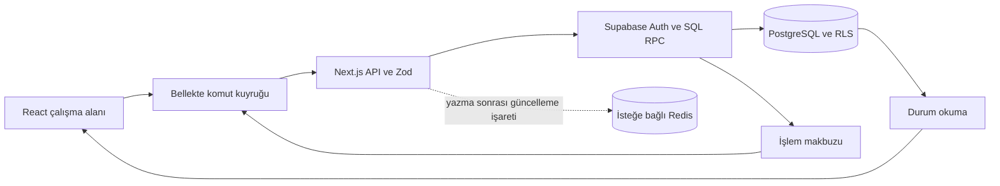

# Mimari ve kod haritası

Bu rehber repodaki kodun yapısını anlatır. Canlı ortamın anahtar, migration veya sağlayıcı durumunu doğrulamaz. İlk kurulum için [SETUP.md](SETUP.md), günlük geliştirme için [DEVELOPMENT.md](DEVELOPMENT.md), ürün kuralları için [PRODUCT.md](PRODUCT.md) okunur.

## Sistem sınırları

Next.js App Router aynı uygulamada sayfaları ve sunucu API'lerini barındırır. React bileşenleri görünümü ve kullanıcı niyetini yönetir; Supabase PostgreSQL/Auth kalıcı veri ve erişim kaynağıdır. İşlemler Zod şemalarından, sunucu yetki kontrolünden ve SQL/RPC kurallarından geçer. İstemcide bir düğmenin gizlenmesi yetkilendirme sayılmaz.

Çekirdek kullanım Google, OpenAI, MCP veya Redis gerektirmez. Bu bağlantılar kendi sunucu modüllerindedir. AI sayısal hesapların kaynağı değildir; süre, net, ilerleme ve uygunluk kod/SQL ile hesaplanır.

## Nereden başlanır?

| Sorumluluk | Kod giriş noktaları |
| --- | --- |
| Sayfa ve API sınırları | [`src/app`](../src/app), [`src/proxy.ts`](../src/proxy.ts) |
| Öğrenci paneli, gezinme, durum yenileme | [`dashboard.tsx`](../src/components/dashboard.tsx) |
| Görev, sayaç, konu ve sonuç ekranları | `src/components/tasks.tsx`, `timer.tsx`, `topics.tsx`, `exams.tsx`, `school-results.tsx` |
| Ortak veri ve komut sözleşmesi | [`domain/types.ts`](../src/lib/domain/types.ts), [`domain/commands.ts`](../src/lib/domain/commands.ts) |
| Komut kuyruğu ve iyimser görünüm | [`study-command-queue.ts`](../src/lib/study-command-queue.ts), `optimistic-command.ts`, `optimistic-timer.ts`, `optimistic-education.ts`, `command-receipt.ts` |
| Öğrenci kimliği ve çekirdek servis | [`server/classroom.ts`](../src/lib/server/classroom.ts), [`server/auth.ts`](../src/lib/server/auth.ts), [`server/service.ts`](../src/lib/server/service.ts) |
| Eğitim profili, dönem, ders, okul puanı | [`education.ts`](../src/lib/education.ts), [`server/education.ts`](../src/lib/server/education.ts), `src/components/education-*.tsx` |
| Süre, ilerleme ve istatistik hesapları | `src/lib/timing.ts`, `progress.ts`, `progress-breakdown.ts`, `study-report.ts`, `study-statistics-*.ts` |
| AI raporu, koçluk, günlük önerisi | `src/lib/server/analysis*.ts`, `coaching.ts`, `journal-ai*.ts`; `src/lib/coaching-*.ts`, `ai-report.ts` |
| Arkadaşlar ve sınıf yönetimi | `src/components/friends-workspace.tsx`, `src/components/classroom/`, `src/lib/server/classroom-*.ts` |
| Ayrı çalışma alanları | `src/components/nova/`, `src/lib/nova/`, `src/lib/server/nova.ts`; `src/components/medicine/`, `src/lib/medicine.ts`, `src/lib/server/medicine.ts` |
| Kalıcı şema ve güvenlik | [`supabase/migrations`](../supabase/migrations); `supabase/owner-setup.sql` ilk sahip kaydı içindir |
| Yerel demo ve katalog araçları | `scripts/classroom-demo-dev.mjs`, `src/lib/server/classroom-demo.ts`, `scripts/build-klu-medicine.py`, `supabase/catalog/` |

## Sayfalar ve API aileleri

Öğrenci panelindeki Bugün, Görevlerim, Konularım, Sınav Sonuçları, Çalışma İstatistikleri, Arkadaşlar, Nova, Günlüğüm, Analiz ve Ayarlar çoğunlukla `/` içindeki React görünüm durumudur. Her sekme için ayrı bir App Router sayfası yoktur.

| URL | İşlev ve sınır |
| --- | --- |
| `/` | Oturumsuzken giriş; kurulumsuzken önizleme; onaylı öğrencide panel. Bekleyen öğrenci `/personalize`, diğer hesaplar `/classroom` yoluna yönlenir. |
| `/personalize` | E-postası doğrulanmış, bekleyen veya onaylı öğrencinin eğitim kurulumu. Bekleyen öğrenci yalnız taslakla çalışır. |
| `/classroom` | Hesap ve başvuru yönetimi. Öğretmen işlevleri geçici olarak duraklatılmıştır. |
| `/register`, `/join`, `/friend-invite` | Başvuru ve davet girişleri; kabul yetkisi ilgili API/SQL katmanındadır. |
| `/forgot-password`, `/reset-password`, `/auth/callback` | Şifre kurtarma ve Supabase Auth dönüşü. |
| `/calendar`, `/oauth/consent` | Google Takvim bağlantı ekranı ve ayrı MCP OAuth izin ekranı. |
| `/nova` | Nova'nın ayrı sayfası; özellik anahtarı ve hesap erişim izni gerekir. |
| `/demo`, `/about`, `/privacy`, `/terms` | Yerel demo hesap seçimi ve bilgilendirme sayfaları. Demo API'si üretimde kapalıdır. |

API dosyaları [`src/app/api`](../src/app/api) altındadır:

| API ailesi | Sunucu modülü / kalıcı işlem |
| --- | --- |
| `/api/state`, `/api/command` | `server/service.ts`; `yks_dashboard_state`, `yks_student_command`, `yks_command` |
| `/api/education` | `server/education.ts`; `education_state`, `education_command` |
| `/api/medicine` | `server/medicine.ts`; `medicine_state`, `medicine_command` |
| `/api/classroom/*`, `/api/register`, `/api/friends/*` | Sınıf kimliği, başvuru, hesap yönetimi ve arkadaş grupları |
| `/api/profile/photo`, `/api/friends/[userId]/photo` | Özel Storage dosyaları ve erişim kontrolü |
| `/api/analysis`, `/api/journal/suggest`, `/api/cron/analysis` | AI/koçluk servisleri; ayrı özellik, kota ve bütçe kapıları |
| `/api/calendar/*` | `server/google-calendar.ts`, `google-calendar-store.ts`; salt okunur Google erişimi |
| `/api/mcp`, `/api/mcp/oauth-protected-resource`, `/api/oauth/*` | OAuth audience doğrulaması ve dar sahip geçidi |
| `/api/nova`, `/api/realtime` | Nova simülasyonu ve çalışma durumu sürüm kontrolü |

`GET /api/nova/chat` ve `POST /api/nova/bridge` kaldırılmış sohbet/Bridge işlevleri için `410 NOVA_CHAT_REMOVED` döndürür. Bunlar kurulum yapılacak etkin entegrasyonlar değildir.

## Kimlik ve rol sınırları

`proxy.ts` Supabase cookie oturumunu yeniler; sayfa ve API'ler kendi yetkilerini ayrıca denetler. `classroomContext()` Auth kullanıcısını `getUser()` ile doğrular ve `classroom_identity` RPC'sinden hesabın rol/durumunu alır.

- **Onaylı öğrenci:** `requireStudyUser()` ile kendi çalışma verisine erişir. Minimal komut yolunda aynı canlı rol denetimi ve yazma `yks_student_command` içinde tek veritabanı işlemidir.
- **Bekleyen öğrenci:** E-postası doğrulanmışsa `requireEducationUser()` üzerinden kendi eğitim taslağını okuyup düzenleyebilir. Profilin kesin kaydı ve çalışma verisi SQL'de onay gerektirir.
- **Öğretmen ve yönetici:** Çalışma paneline öğrenci gibi girmez. Yönetici onay/hesap işlemleri sınıf servisindedir. Öğretmen özelliği şu anda hem `src/lib/classroom/availability.ts` hem `20261013122500_pause_teacher_updates.sql` ile kapalıdır; yalnız ön yüz bayrağını açmak yeterli değildir.
- **İlk sahip hesabı:** `requireOwnerContext()` doğrulanmış e-posta, `owner_allowlist` UUID'si ve onay durumunu birlikte arar. Özel MCP ve günlük AI önerisi gibi eski sahip sınırları, genel öğrenci erişimiyle aynı değildir.

Tarayıcı oturumuyla yazan API'ler `sameOrigin()` kullanır. JSON boyutu ve şeması sınırlandırılır; API yanıtları `private, no-store` döner. MCP cookie yerine doğrulanmış OAuth bearer, doğru issuer/audience/client ve sahip izni kullanır; sunucu anahtarıyla yalnız dar `mcp_owner_*` RPC'lerini çağırır.

Giriş ve kayıt denemeleri sunucu anahtarıyla çağrılan ortak veritabanı sayaçlarıyla sınırlandırılır. Girişte bir dakikada e-posta başına 10, IP başına 50; kayıtta 15 dakikada e-posta başına 3, IP başına 5 deneme kabul edilir. Yalnız Vercel'in doğrulanabilir proxy başlığı IP kaynağıdır; diğer ortamlarda sabit ortak IP sayacı kullanılır. E-posta/IP değerleri HMAC ile özetlenir. Her akış en fazla 5.000 sayaç ayırır; her istekte en çok 128 süresi dolmuş sayaç temizlenir. Kısıtlanan IP yeni e-posta satırı oluşturmaz; giriş güvenlik deposu yanıt vermezse Auth çağrısına geçilmez.

HTML ve API yanıtları `frame-ancestors 'none'`, `X-Frame-Options: DENY` ve `nosniff` başlıklarını taşır. Uygulama başka bir sayfanın iframe'i içinde gösterilmez; OAuth yönlendirmeleri ve normal gezinme korunur.

## Okuma, yazma ve eşzamanlılık

`Dashboard` `/api/state` ile `AppState` yükler. `getState()` güncel `yks_dashboard_state` izdüşümünü okur; yalnız RPC migration'ı eksikse eski `yks_state` yoluna düşer. İsteğe bağlı Redis durum cache'i, veritabanındaki kullanıcı/sürüm denetimi başarılı olmadan veri döndürmez; Redis hatasında doğrudan veritabanı okunur.

Bir görev değişikliği şu yolu izler:

1. Ekran `command(type, payload)` çağırır; her gerçek niyet için UUID `request_id` oluşturulur.
2. Bellekteki kuyruk iyimser görünümü hesaplar, bağımlı işlemleri sıraya koyar ve bir seferde bir HTTP isteği gönderir.
3. `/api/command` girdiyi doğrular. Minimal yol `yks_student_command`, tam durum döndüren yol `yks_command` kullanır.
4. SQL sahipliği, hesap durumunu, `expected_revision` değerini ve işlem makbuzunu kontrol eder. Başarıda `{id, request_id, replayed}` döner. Aynı kimlikle aynı payload yeniden gönderilebilir; farklı payload kimlik çakışmasıdır.
5. İstemci makbuzu kabul eder, gerektiğinde durumu yeniler. Ağ/5xx belirsizliğinde kuyruk duraklar; kullanıcı yeniden denediğinde aynı işlem kimliği korunur. Çakışmada güncel veri okunur.

Bu kuyruk kalıcı çevrimdışı depolama değildir. Sekme kapanınca bekleyen niyetleri geri getiren IndexedDB kuyruğu yoktur. SQL makbuzu kalıcı başarı kanıtıdır; iyimser görünüm tek başına kayıt kanıtı değildir.

[`REALTIME.md`](features/REALTIME.md) yolunda anlatılan `/api/realtime?session=1`, Redis'teki kullanıcıya özgü opak sürüm değerini kontrol eder. Başarılı yazmadan sonra işaret en iyi çabayla gönderilir. Yenileme/polling onarımı korunur; bu mekanizma çalışma verisini Redis'e taşımaz ve yazmanın başarısını belirlemez.

## Veritabanı haritası ve korunacak kurallar

| Veri ailesi | Başlıca tablolar |
| --- | --- |
| Çalışma | `profiles`, `tasks`, `topics`, `topic_history`, `study_sessions`, `study_intervals`, `manual_study_entries`, `daily_plan_versions` |
| Soru, deneme ve günlük | `practice_entries`, `exams`, `exam_results`, `exam_format_versions`, `journal_entries`, `day_marks` |
| Eğitim | `education_profiles`, `education_drafts`, `education_terms`, `education_courses`, `course_exam_results` |
| Hesap ve sınıf | `classroom_accounts`, `classroom_applications`, `classroom_*`; özel arkadaş grup tabloları |
| Analiz ve denetim | `analysis_*`, özel `coaching_*` / `topic_review_*` / AI bütçe tabloları, `command_receipts`, `audit_log` |
| Ayrı özellikler | `nova_*`, `medicine_*`, `google_calendar_connections`; özel Storage bucket'ları |

Süre saniye, zaman damgası UTC, yerel gün `YYYY-MM-DD` olarak tutulur. RLS, kullanıcıya bağlı yabancı anahtarlar ve RPC kontrolleri başka hesaba ait kimlikleri reddeder. Ders adı ilişki anahtarı değildir; kalıcı `course_id` ve tarihsel ad snapshot'ları kullanılır. Kesinleşmiş sayaç/manuel çalışma süreleri ve bitmiş oturum aralıkları SQL'de değişmezdir. Görev bitirmek konu hâkimiyetini, sayaç bitirmek görev tamamlanmasını kendiliğinden değiştirmez.

Şema geçmişi `supabase/migrations/*.sql` dosyalarının sırasıdır. `supabase/20260924000000_initial.sql.reference` uygulanacak migration değildir; `seed.sql` kasıtlı olarak boştur. Yeni şema değişikliği yeni migration ile yapılır; eski migration dosyaları yeniden yazılmaz. Yeni alanın cache sürümüne ve durum izdüşümlerine etkisi de kontrol edilir.

## Bir değişikliği kodda izleme

Örneğin görev alanına yeni bir kural ekleniyorsa `tasks.tsx` → `domain/commands.ts` → `server/service.ts` → SQL komut dalı sırasını izle. Veriyi ekranda hemen gösteren `optimistic-command.ts`, makbuz eşlemesi ve `AppState` tipini birlikte incele. Yalnız API şemasını değiştirmek SQL, eski istemci ve iyimser görünüm sözleşmesini güncellemez.

Davranışa göre ilgili `tests/*.test.ts`, `supabase/tests/*.test.ts` ve tarayıcı senaryolarını çalıştır; komutlar ve paketlerin sınırları [TESTING.md](TESTING.md) içindedir. Eğitim/derse dokunan işlerde [öğrenci sözleşmesini](features/STUDENT_PERSONALIZATION.md), ayrı çalışma alanlarında [Nova](features/NOVA.md) veya [Kırklareli Tıp](features/KIRKLARELI_MEDICINE.md) rehberini de oku.
